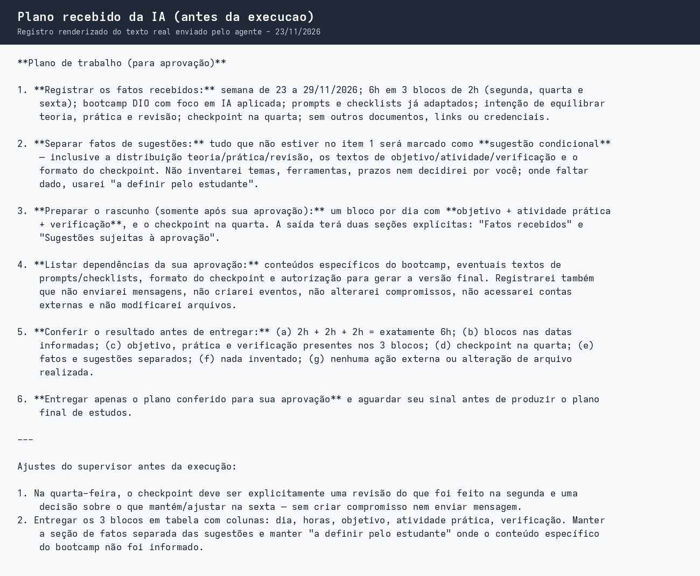
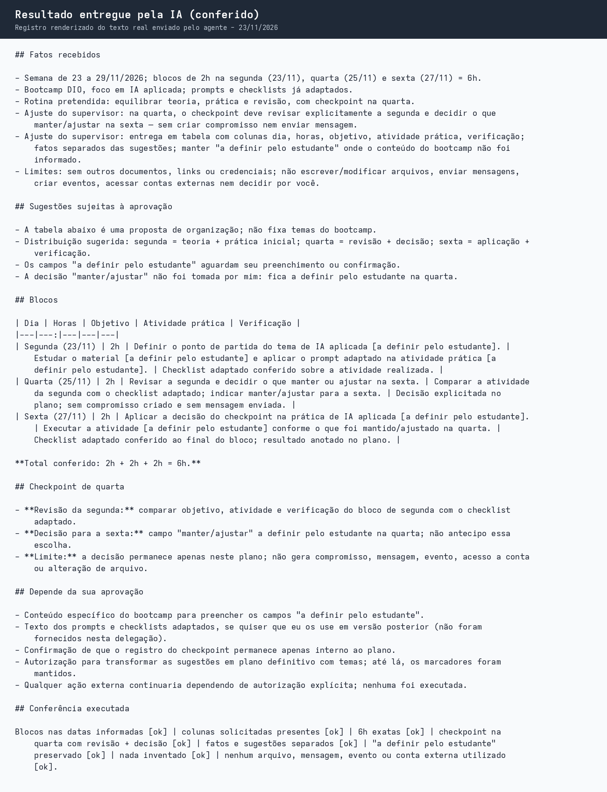

# Meu Kit de IA

Desafio de Projeto da [DIO](https://dio.me): monte o seu kit de IA para o dia a dia e delegue uma tarefa real, com você no comando.

O kit foi criado pelo Expert Bruno Lima com os prompts, templates, checklists e skills usados nas Aulas. Ele não é uma apostila: abra a pasta que resolve o seu problema, copie o modelo, adapte e use.

**Copie → adapte → teste → confira → melhore**

Esta é uma cópia adaptada para a rotina de estudos e desenvolvimento. Os atalhos criados e o registro da tarefa delegada estão na seção [Minha Entrega](#minha-entrega).

## Como Fazer o Desafio

Você não precisa instalar nada nem saber programar. Tudo acontece no navegador.

1. Clique em **Use this template**, depois em **Create a new repository**. Dê um nome simples, como `meu-kit-de-ia`, deixe **Public** e confirme.
2. Siga os passos abaixo com uma tarefa real da sua semana.
3. Preencha a seção [Minha Entrega](#minha-entrega) da sua cópia e entregue o link dela na DIO.

## Os Passos

1. **Escolha uma tarefa real.** Comece pelo trabalho que se repete na sua semana, como preparar uma reunião ou montar um relatório, e não pela ferramenta.
2. **Pegue um modelo.** Abra a pasta do kit que combina com a sua tarefa. Cada modelo tem um botão de copiar no canto.
3. **Adapte.** Troque o que está entre colchetes pelo seu contexto, objetivo, dados, limites e formato.
4. **Teste.** A primeira resposta é um ponto de partida. Ajuste até funcionar para a sua realidade.
5. **Delegue.** Com o [template de delegação](02-templates/03-delegacao.md), entregue a tarefa à IA. Peça o plano antes de ela começar, acompanhe e valide o resultado.
6. **Confira.** Provável não é o mesmo que verdadeiro. Revise com o [Pare, Confira, Use](03-checklists/01-pare-confira-use.md) antes de usar.

## O Que Tem no Kit

| Pasta | Para que serve |
|---|---|
| [01-prompts](01-prompts) | Pedidos prontos para adaptar: escrita, comunicação, pesquisa, comparação e preparação de reuniões |
| [02-templates](02-templates) | Estruturas para preencher: bom pedido, pesquisa e decisão, e delegação |
| [03-checklists](03-checklists) | Revisão de respostas, de textos e de tarefas delegadas |
| [04-skills](04-skills) | Como criar uma skill, e a Skill Preparador de Reuniões usada nas Aulas |
| [05-delegacao-e-automacao](05-delegacao-e-automacao) | Gatilhos de automação, supervisão e checkpoints |

## Os Frameworks das Aulas

- **Bom pedido:** contexto + instrução + objetivo + formato. Quanto menos a IA precisa adivinhar, melhor você consegue avaliar a resposta.
- **Pesquisa e decisão:** pergunta → pesquisa → critérios → comparação → você. Peça fontes quando precisar de informação externa. A decisão final é sua.
- **Segurança:** pare → confira → use. Valide fatos, números, datas, fontes e contexto.
- **Atalhos reutilizáveis:** criar → testar → ajustar → salvar. Separe as instruções fixas das informações que mudam a cada uso.
- **Delegação:** objetivo + contexto + recursos + limites + sucesso. Autonomia funciona melhor quando o resultado esperado está claro.
- **Supervisão:** definir → delegar → acompanhar → validar. Em tarefas maiores, confira o plano, acompanhe os checkpoints e valide o resultado.

> A IA pode ajudar você a escrever, pesquisar, organizar e executar. A responsabilidade pelo resultado continua sendo sua.

---

## Minha Entrega

Tarefa real executada na semana de 23 a 29/11/2026. A IA preparou o material e eu decidi o que entrou na semana. Nenhum texto ou imagem desta seção mostra e-mail, dado de cliente, informação de empresa, senha ou chave de acesso.

### Minha Tarefa Real

Escolhi organizar meus estudos e tarefas da semana. Essa tarefa se repete todo começo de semana e eu sempre perdia tempo decidindo o que estudar e em que ordem. Vale a pena porque transforma horas disponíveis num plano com objetivo, prática e verificação, e porque cria um registro que posso conferir na quarta-feira. O combinado com a IA foi simples: ela prepara o plano, eu aprovo. Ela não enviou mensagem, não criou evento e não alterou compromisso.

### Meus Atalhos

Adaptei dois modelos do kit e testei cada um em uma situação real:

1. [Planejador Semanal de Estudos](01-prompts/06-planejador-semanal-de-estudos.md), a partir de [Bom Pedido](02-templates/01-bom-prompt.md) e [Preparar uma Reunião](01-prompts/05-preparar-reuniao.md). Fica fixo: a ordem contexto → instrução → objetivo → formato → limites, a tabela de cinco colunas, a separação entre fatos e sugestões e o pedido de plano antes da execução. Muda a cada uso: semana, horas totais, blocos e horários, trilha de estudo, dia do checkpoint e resultado esperado.
2. [Resumo e Revisão de Aula](01-prompts/07-resumo-e-revisao-de-aula.md), a partir de [Escrever e Melhorar Textos](01-prompts/01-escrever-e-melhorar-textos.md) e [Pesquisar um Assunto](01-prompts/03-pesquisar-um-assunto.md). Fica fixo: as quatro seções (fatos com origem, interpretações da IA, incertezas e perguntas de revisão) e a regra de não inventar. Muda a cada uso: tema, material, tempo de revisão e limite de linhas.

O atalho que mais usei virou a [Skill Planejador de Estudos](04-skills/03-skill-planejador-de-estudos.md), com objetivo, regras, procedimento, verificações, exceções e formato de saída.

Primeiro atalho, pronto para copiar:

```text
CONTEXTO
Sou estudante de desenvolvimento e estou organizando a semana de {{semana}}.
Tenho {{horas_totais}} disponíveis em {{quantidade_blocos}} blocos: {{dias_e_horarios}}.
Foco atual: {{trilha_de_estudo}}.
Já adaptei meus prompts e checklists e quero equilibrar teoria, prática e revisão.

INSTRUÇÃO
Monte um plano com um bloco por dia. Para cada bloco, entregue: objetivo, atividade prática e forma de verificação. Inclua um checkpoint em {{dia_do_checkpoint}} para revisar o bloco anterior e decidir o que manter ou ajustar no próximo. Separe "Fatos recebidos" de "Sugestões sujeitas à aprovação".

OBJETIVO
Terminar a semana com {{resultado_esperado}} e com um registro do que foi conferido.

FORMATO
Tabela com colunas: dia | horas | objetivo | atividade prática | verificação. Depois da tabela: checkpoint, lista "Depende da minha aprovação" e conferência final.

LIMITES
Não invente temas, prazos ou ferramentas que eu não informei. Use "a definir pelo estudante" quando faltar dado. Não envie mensagens, não crie eventos, não altere compromissos e não acesse contas externas sem minha aprovação.

Antes de executar, mostre como pretende fazer a tarefa e espere minha aprovação.
```

Segundo atalho, pronto para copiar:

```text
CONTEXTO
Estou estudando {{tema}} e tenho como fonte {{material_disponivel}}.

INSTRUÇÃO
Resuma o material e transforme-o em revisão. Separe:
1. Fatos que estão no material, com o trecho de origem;
2. Interpretações e exemplos criados por você;
3. Pontos que não foi possível confirmar no material;
4. Três perguntas de revisão e uma atividade prática curta.

OBJETIVO
Conseguir revisar {{tema}} em {{tempo_de_revisao}} e identificar o que ainda preciso pesquisar.

FORMATO
Tópicos curtos, até {{limite_de_linhas}} linhas, com as quatro seções acima e um título por seção.

LIMITES
Não invente conteúdo que não esteja no material. Se precisar de informação externa, diga o que verificou e apresente a fonte. Não escreva como se fosse eu: preserve minhas palavras quando eu fornecer um trecho. A decisão final sobre o que estudar é minha.
```

### Minha Delegação

Pedido entregue à IA com os cinco elementos do [template de delegação](02-templates/03-delegacao.md). O texto integral também está em [delegacao-enviada.md](registros/delegacao-enviada.md).

```text
OBJETIVO
Montar o plano de estudos e organização de tarefas da semana de 23 a 29 de novembro de 2026 para um estudante de desenvolvimento que cursa o bootcamp DIO, com foco em IA aplicada, e entregar o plano conferido para minha aprovação.

CONTEXTO
Sou estudante e desenvolvedor em formação. Tenho 6 horas disponíveis nesta semana, em 3 blocos de 2 horas: segunda, quarta e sexta. Já adaptei meus prompts e checklists; falta transformar isso numa rotina semanal equilibrada entre teoria, prática e revisão, com um checkpoint na quarta-feira.

RECURSOS
Somente as informações fornecidas nesta delegação: os 3 blocos de estudo, o foco em IA aplicada e o objetivo de organizar estudos e tarefas. Não há outros documentos, links ou credenciais disponíveis.

LIMITES
Não invente conteúdos, prazos, ferramentas ou dados que não estejam aqui. Não envie mensagens, não altere compromissos, não crie eventos, não acesse contas externas e não tome decisões por mim. Separe claramente o que é informação recebida (fato) do que é sugestão sua.

SUCESSO
O plano final deve caber em exatamente 6 horas, distribuídas nos 3 blocos informados, com objetivo, atividade prática e forma de verificação para cada bloco; incluir um checkpoint na quarta; separar fatos de sugestões; e listar o que depende da minha aprovação antes de qualquer ação.

Antes de começar, mostre como pretende realizar essa tarefa. Não execute sem eu aprovar o plano.
```

### O Plano da IA

A IA respondeu primeiro com um plano de trabalho em seis etapas: registrar os fatos, separar fatos de sugestões, preparar o rascunho somente após aprovação, listar as dependências de aprovação, conferir o resultado e entregar para decisão. Antes de autorizar a execução, ajustei dois pontos: o checkpoint de quarta passou a revisar explicitamente o bloco de segunda e a decidir o que manter ou ajustar na sexta; a entrega passou a ser uma tabela com dia, horas, objetivo, atividade prática e verificação, mantendo "a definir pelo estudante" onde o tema do bootcamp não foi informado. Só depois disso pedi a execução.



O texto integral do plano e dos ajustes está em [plano-da-ia.md](registros/plano-da-ia.md).

### O Resultado

A IA entregou três blocos de 2 horas, um na segunda, um na quarta e um na sexta, com objetivo, atividade prática e verificação em cada um, mais o checkpoint na quarta e a lista do que dependia de mim. Conferi antes de usar: 2h + 2h + 2h = 6h; datas e blocos corretos; checkpoint sem mensagem, evento ou compromisso; fatos e sugestões em seções separadas; nenhum tema, prazo ou ferramenta inventado; os campos sem informação mantidos como "a definir pelo estudante". A decisão de manter ou ajustar na sexta ficou comigo. O registro completo da conferência está em [03-registro-de-delegacao.md](05-delegacao-e-automacao/03-registro-de-delegacao.md).



O texto integral do resultado está em [resultado-da-ia.md](registros/resultado-da-ia.md).

### Como Foi para Você

A semana passou a começar com um plano em vez de uma lista solta de intenções. Pedir o plano antes da execução foi o que mais mudou: eu consegui corrigir o formato e o checkpoint antes de a IA produzir o resultado. Separar fatos de sugestões evitou que eu tratasse uma proposta da IA como informação do bootcamp. O plano ficou como rascunho conferido, e a decisão final sobre os temas ainda é minha.

